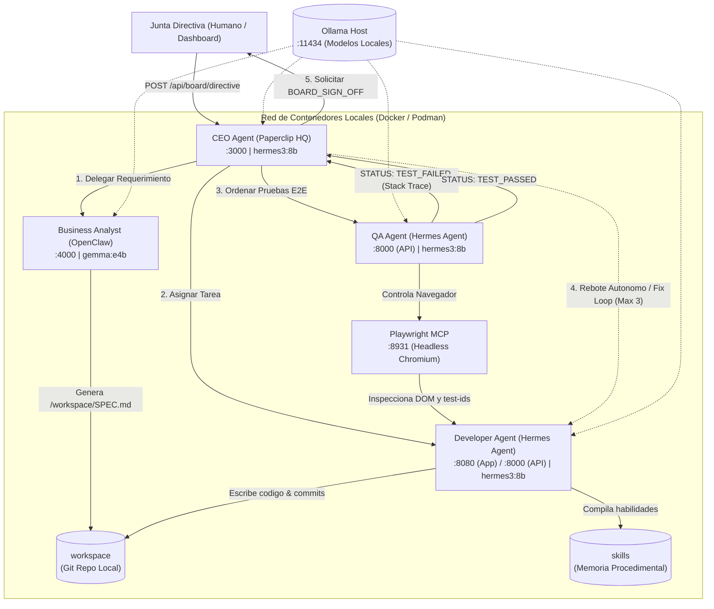

# The Localhost Company — OpenHUB 2026 Bootcamp

> **Creating a Startup with your Favorite Local AI Models**  
> Repositorio oficial de implementación para el bootcamp práctico en **OpenHUB 2026 (UNAPEC)** impartido por el **Ing. Iván Vergés**.

Una startup de software completa (CEO, Business Analyst, Full-Stack Developer y QA Engineer) que opera **100% en contenedores locales**, utilizando modelos locales vía **Ollama** y validación E2E real mediante **Playwright MCP**. Ni una sola línea de código, prompt o credencial sale de tu máquina (`localhost`).

---

## 📑 Tabla de Contenidos

- [Arquitectura del Sistema](#-arquitectura-del-sistema)
- [Requisitos Previos](#-requisitos-previos)
- [Modelos de Ollama Recomendados](#-modelos-de-ollama-recomendados)
- [Paso a Paso: Instalación y Configuración](#-paso-a-paso-instalación-y-configuración)
  - [Paso 1: Clonar y Preparar el Entorno](#paso-1-clonar-y-preparar-el-entorno)
  - [Paso 2: Iniciar Ollama y Descargar Modelos](#paso-2-iniciar-ollama-y-descargar-modelos)
  - [Paso 3: Levantar los 5 Contenedores](#paso-3-levantar-los-5-contenedores)
  - [Paso 4: Comprobar Estado de los Servicios](#paso-4-comprobar-estado-de-los-servicios)
- [Guía de Uso: Ejecutando la Empresa](#-guía-de-uso-ejecutando-la-empresa)
  - [1. Enviar una Directiva de Negocio](#1-enviar-una-directiva-de-negocio)
  - [2. Monitorear el Tablero Kanban y Logs en Vivo](#2-monitorear-el-tablero-kanban-y-logs-en-vivo)
  - [3. Demostración de Self-Healing (Inyección de Bugs)](#3-demostración-de-self-healing-inyección-de-bugs)
  - [4. Aprobación Final de la Junta Directiva (Board Sign-Off)](#4-aprobación-final-de-la-junta-directiva-board-sign-off)
- [Personalización y Configuración](#-personalización-y-configuración)
- [Estructura del Proyecto](#-estructura-del-proyecto)
- [Referencia de la API REST](#-referencia-de-la-api-rest)
- [Solución de Problemas Frecuentes (FAQ)](#-solución-de-problemas-frecuentes-faq)

---

## 🏛 Arquitectura del Sistema



| Rol Corporativo | Contenedor | Puerto(s) | Modelo Predeterminado | Responsabilidad Principal |
| :--- | :--- | :--- | :--- | :--- |
| **CEO Agent** | `localhost-ceo-hq` (`paperclip-hq`) | `:3000` | `hermes3:8b` | Plano de control, orquestación, tablero Kanban web, auditoría y control de reintentos (máx 3). |
| **Business Analyst** | `localhost-analyst` (`analyst-openclaw`) | `:4000` | `gemma:e4b` | Descompone directivas en especificaciones técnicas con selectores `data-testid` y casos Gherkin en `/workspace/SPEC.md`. |
| **Developer Agent** | `localhost-developer` (`dev-hermes`) | `:8080` (App)<br>`:8000` (API) | `hermes3:8b` | Implementa la app web (`index.html`, `checkout.js`), realiza commits Git locales y compila memoria procedimental en `./skills/`. |
| **Playwright MCP** | `localhost-playwright-mcp` (`playwright-mcp`) | `:8931` | *(MCP Server)* | Servidor MCP que expone un navegador Chromium Headless para testing E2E interactivo en la red local. |
| **QA Engineer** | `localhost-qa` (`qa-hermes`) | `:8000` (API) | `hermes3:8b` | Conecta con Playwright MCP, ejecuta los tests contra `http://dev-hermes:8080` y emite `STATUS: TEST_PASSED` o `STATUS: TEST_FAILED`. |

---

## 💻 Requisitos Previos

### Hardware Recomendado
- **RAM del Sistema**: Mínimo 8 GB (16 GB o más recomendado si se corre inferencia en CPU o memoria unificada).
- **Disco**: 10 GB de espacio libre para imágenes de contenedores y pesos de modelos.
- **Aceleración por GPU (Altamente Recomendado)**:
  - **NVIDIA GPU (CUDA)**:
    - **VRAM Recomendada**: Mínimo **6 GB a 8 GB de VRAM** para modelos cuantizados de 3B–8B (ej. RTX 3060, RTX 4060, RTX 3070 o GPUs de servidor T4 / A10G / A100 / L4).
    - **12 GB o más de VRAM** (ej. RTX 3060 12GB, RTX 4070, RTX 3080/4080 o superior) permite cargar modelos de 8B parámetros en memoria de video completa con inferencia instantánea (offloading 100% a GPU) y contextos extensos.
    - Requiere drivers NVIDIA actualizados y soporte para CUDA (Ollama detecta CUDA automáticamente).
  - **Apple Silicon**: M1 hasta M6 (Pro / Max / Ultra) con memoria unificada (Metal activado automáticamente en Ollama).
  - **CPU (Fallback)**: Procesadores Intel / AMD modernos con instrucciones AVX2 (funciona, pero con tiempos de respuesta más altos).

### Software Requerido
1. **Docker con Docker Compose** (o **Podman con Podman Compose**):
   - macOS: [Docker Desktop](https://www.docker.com/products/docker-desktop/) o [OrbStack](https://orbstack.dev/) o `podman`.
   - Linux: `docker` y `docker-compose-plugin` (o `podman` y `podman-compose`).
   - Windows: Docker Desktop con backend **WSL2** activado.
2. **Ollama**:
   - Descargar e instalar desde [ollama.com](https://ollama.com/).
3. **Herramientas de línea de comandos**:
   - `curl`, `git`, `bash`.

---

## 🦙 Modelos de Ollama Recomendados

El sistema está configurado por defecto para utilizar:
- `hermes3:8b` para razonamiento del CEO, desarrollo full-stack y análisis de QA.
- `gemma:e4b` (o `gemma3:4b` / `gemma2:2b` / `qwen2.5-coder:3b`) para el Business Analyst.

> **Nota:** El sistema implementa *fallback automático*: si no tienes `hermes3:8b`, el plano de control buscará automáticamente modelos disponibles como `llama3.2`, `qwen2.5:7b`, `gemma3:4b` o cualquier modelo descargado en tu Ollama.

---

## 🚀 Paso a Paso: Instalación y Configuración

### Paso 1: Clonar y Preparar el Entorno

```bash
# 1. Clonar el repositorio
git clone https://github.com/ivan-verges/The-Localhost-Company.git
cd TheLocalhostCompany

# 2. Ejecutar el script automatizado de preparación
chmod +x scripts/*.sh
./scripts/setup.sh
```

El script `./scripts/setup.sh`:
- Crea las carpetas requeridas (`workspace`, `skills`, `tests`, `config`, `prompts`).
- Inicializa el repositorio local en `./workspace`.
- Detecta si usas Docker o Podman.
- Verifica si Ollama está en ejecución y los modelos disponibles.

---

### Paso 2: Iniciar Ollama y Descargar Modelos

Para que los contenedores puedan comunicarse con Ollama en tu máquina anfitriona, inicia Ollama escuchando en todas las interfaces:

```bash
# En una terminal dedicada (o como servicio del sistema):
OLLAMA_HOST=0.0.0.0:11434 ollama serve
```

Descarga los modelos recomendados:

```bash
# Modelo principal de razonamiento y código
ollama pull hermes3:8b

# Modelo para el analista (o usa qwen2.5-coder o gemma3)
ollama pull gemma3:4b
ollama cp gemma3:4b gemma:e4b
```

*(Si tu máquina cuenta con 8 GB de RAM o menos, puedes utilizar modelos más ligeros como `ollama pull qwen2.5-coder:3b` o `ollama pull llama3.2:3b`).*

---

### Paso 3: Levantar los 5 Contenedores

#### Opción A: Con Docker Compose (Recomendado)
```bash
docker compose up --build -d
```

#### Opción B: Con Podman Compose
```bash
podman-compose up --build -d
```

---

### Paso 4: Comprobar Estado de los Servicios

Verifica que los 5 contenedores estén corriendo (`Up`):

```bash
docker ps --format "table {{.Names}}\t{{.Status}}\t{{.Ports}}"
```

Deberías ver:
- `localhost-ceo-hq` en el puerto `0.0.0.0:3000->3000`
- `localhost-analyst` en el puerto `0.0.0.0:4000->4000`
- `localhost-developer` en el puerto `0.0.0.0:8080->8080`
- `localhost-playwright-mcp` en el puerto `0.0.0.0:8931->8931`
- `localhost-qa` en la red interna comunicándose con Playwright MCP

---

## 🎮 Guía de Uso: Ejecutando la Empresa

### 1. Enviar una Directiva de Negocio

Puedes enviar la directiva de 3 formas:

#### A través del Dashboard Web:
Abre tu navegador en **[http://localhost:3000](http://localhost:3000)** y haz clic en **"Enviar Directiva Demo"** (o escribe tu propia directiva).

#### A través del Script provisto:
```bash
./scripts/send-directive.sh
```

#### A través de `curl`:
```bash
curl -X POST http://localhost:3000/api/board/directive \
  -H "Content-Type: application/json" \
  -d '{
    "project": "Módulo de Checkout con Validador de Cupones",
    "directive": "Crear una aplicación web de checkout con un precio base de $100. Si el usuario ingresa el cupón OPENHUB20 se aplica un 20% de descuento ($80 final). Si ingresa un cupón inválido debe mostrarse una alerta de error y mantener el total en $100."
  }'
```

---

### 2. Monitorear el Tablero Kanban y Logs en Vivo

Entra a **[http://localhost:3000](http://localhost:3000)** para ver en tiempo real:
1. **Etapa 1 (Business Analysis)**: OpenClaw redacta los criterios de aceptación y selectores `data-testid` en `/workspace/SPEC.md`.
2. **Etapa 2 (Engineering)**: Hermes Dev genera `index.html` y `checkout.js`, hace commit en Git y levanta la app en el puerto `:8080`. Puedes ver la app construida abriendo **[http://localhost:8080](http://localhost:8080)**.
3. **Etapa 3 (E2E QA Testing)**: Playwright MCP abre un navegador real sin cabeza, escribe en los inputs y valida que `$100 - 20% = $80`. Emite `STATUS: TEST_PASSED`.
4. **Etapa 4 (CEO Review)**: El CEO redacta el Resumen Ejecutivo para la Junta Directiva.

---

### 3. Demostración de Self-Healing (Inyección de Bugs)

Una de las capacidades más potentes de este proyecto es el **rebote autónomo ante fallos**:

1. Ejecuta el script de inyección:
   ```bash
   ./scripts/inject-bug.sh
   ```
   *(O haz clic en el botón **"🐞 Inyectar Bug Demo ($70 en vez de $80)"** en el dashboard)*.
2. ¿Qué ocurre internamente?
   - Se modifica `workspace/checkout.js` para aplicar un descuento incorrecto de `$30` (dando `$70` en vez de `$80`).
   - El **QA Agent** ejecuta la suite con **Playwright MCP** y detecta: `Expected: $80, Received: $70` (`STATUS: TEST_FAILED`).
   - El **CEO Agent** captura el stack trace y snapshot del DOM, e instruye al **Developer Agent** para repararlo.
   - El Developer repara el código, registra un nuevo commit Git y compila una habilidad preventiva en `./skills/`.
   - Playwright MCP re-evalúa y confirma `STATUS: TEST_PASSED`.

---

### 4. Aprobación Final de la Junta Directiva (Board Sign-Off)

Cuando el flujo termina con éxito, el estado queda en `AWAITING_BOARD_APPROVAL`:
- En la interfaz web [http://localhost:3000](http://localhost:3000), haz clic en el botón **"Firmar Aprobación (BOARD_SIGN_OFF)"**.
- O vía terminal:
  ```bash
  curl -X POST http://localhost:3000/api/board/approve
  ```

---

## ⚙️ Personalización y Configuración

### Organigrama y Parámetros en `config/company.yaml`

Puedes ajustar el comportamiento de la empresa editando [config/company.yaml](file:///Users/ivanverges/Projects/TheLocalhostCompany/config/company.yaml):

```yaml
company:
  name: "The Localhost Company"
  max_fix_iterations: 3             # Límite de rebotes Dev <-> QA antes de escalar al humano
  require_board_approval_on_release: true

roles:
  ceo:
    title: "Chief Executive Officer"
    model: "hermes3:8b"              # Cambia el modelo de Ollama según tu hardware
  business_analyst:
    title: "Lead Business Analyst"
    model: "gemma:e4b"
  developer:
    title: "Senior Full-Stack Developer"
    model: "hermes3:8b"
  qa_engineer:
    title: "Autonomous QA Automation Engineer"
    model: "hermes3:8b"
```

### Personalizar los Prompts de los Agentes

En la carpeta [prompts/](file:///Users/ivanverges/Projects/TheLocalhostCompany/prompts/) puedes cambiar las instrucciones de cada rol:
- `prompts/ceo.md`: Reglas de delegación y gestión de presupuesto de reintentos.
- `prompts/analyst.md`: Estándar para escribir `SPEC.md` con Gherkin y `data-testid`.
- `prompts/developer.md`: Reglas de programación web, commits limpios y compilación de skills.
- `prompts/qa.md`: Criterios de validación E2E y formato de reporte de errores.

---

## 📂 Estructura del Proyecto

```text
TheLocalhostCompany/
├── config/
│   └── company.yaml          # Definición de la empresa, roles, modelos y límites
├── prompts/                  # Prompts de sistema para cada agente
│   ├── ceo.md
│   ├── analyst.md
│   ├── developer.md
│   └── qa.md
├── scripts/
│   ├── setup.sh              # Inicialización y validación del entorno
│   ├── send-directive.sh     # Disparador de requerimiento de negocio
│   └── inject-bug.sh         # Simulador de bug para demo de self-healing
├── services/
│   ├── paperclip-hq/         # Plano de control, FastAPI + Dashboard Web (CEO)
│   ├── openclaw/             # Microservicio del Analista de Negocio
│   ├── hermes-agent/         # Microservicio de Ingeniería y QA (Dev / QA)
│   └── playwright-mcp/       # Servidor MCP con Chromium Headless
├── workspace/                # Repositorio Git donde los agentes construyen la app
├── skills/                   # Memoria procedimental compilada por los agentes
├── tests/                    # Suites de prueba generadas por el QA Agent
├── docker-compose.yml        # Orquestación estándar con Docker
├── podman-compose.yml        # Orquestación para entornos Podman / Red Hat
└── README.md
```

---

## 🔌 Referencia de la API REST

El plano de control expone los siguientes endpoints en `http://localhost:3000`:

| Método | Endpoint | Descripción | Payload Ejemplo |
| :--- | :--- | :--- | :--- |
| `GET` | `/` | Retorna el dashboard web interactivo. | — |
| `GET` | `/api/state` | Devuelve el estado actual de la empresa, logs y artefactos. | — |
| `POST` | `/api/board/directive` | Recibe una directiva e inicia el flujo de trabajo. | `{"project": "...", "directive": "..."}` |
| `POST` | `/api/demo/inject-bug` | Inyecta el bug de $30 de descuento y re-ejecuta QA. | `{}` |
| `POST` | `/api/board/approve` | Aprueba el release final (firma de la Junta). | `{}` |

---

## 🛠 Solución de Problemas Frecuentes (FAQ)

### 1. `docker compose up` falla al conectarse a Ollama (`host.containers.internal`)
**Causa**: Ollama solo está escuchando en `127.0.0.1` en lugar de `0.0.0.0`.  
**Solución**:
```bash
# En macOS / Linux
OLLAMA_HOST=0.0.0.0:11434 ollama serve
```
En Docker Desktop, `host.docker.internal` está habilitado por defecto mediante la directiva `extra_hosts` incluida en `docker-compose.yml`.

### 2. Error: "checkout.js aún no existe en /workspace" al inyectar el bug
**Causa**: Intentaste ejecutar `./scripts/inject-bug.sh` antes de que el ciclo inicial completara la implementación.  
**Solución**: Primero envía la directiva con `./scripts/send-directive.sh`, espera a que el dashboard marque la etapa de QA completada, y luego inyecta el bug.

### 3. Falta de memoria RAM o lentitud con modelos grandes
**Solución**:
Puedes usar modelos cuantizados más pequeños. Cambia en `config/company.yaml` o descarga:
```bash
ollama pull qwen2.5-coder:3b
ollama pull llama3.2:3b
```
Paperclip detecta automáticamente los modelos disponibles en tu Ollama.

### 4. Reiniciar el entorno a un estado limpio
Si deseas reiniciar todo el flujo desde cero:
```bash
# Detener los contenedores
docker compose down

# Limpiar el workspace y los skills
rm -rf workspace/* skills/* tests/*
touch workspace/.gitkeep skills/.gitkeep tests/.gitkeep

# Volver a levantar
docker compose up -d
```

---

## 🎓 Créditos y Licencia

Desarrollado para el taller **"The Localhost Company"** de **OpenHUB 2026 — Universidad APEC (UNAPEC)**.  
**Autor:** Ing. Iván Vergés  
**Licencia:** MIT — Siéntete libre de adaptarlo, modificarlo y usarlo para tus propios experimentos con agentes autónomos locales.
